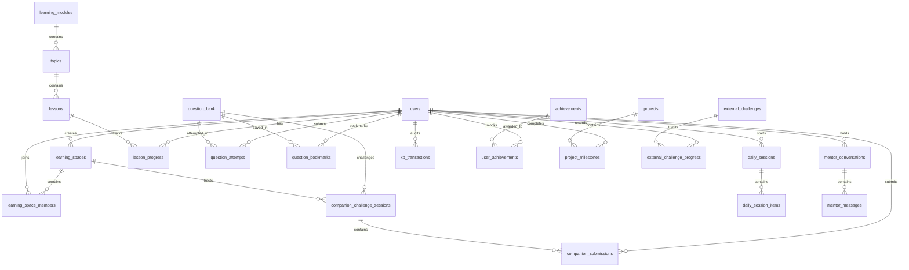

# Database Schema Specification — JavaQuest

JavaQuest uses a relational schema with support for PostgreSQL (production/Docker) and SQLite (zero-config local development).

---

## 1. Entity-Relationship Overview

---

## 2. Table Specifications

### 2.1 `users`
| Column | Type | Constraints | Description |
| :--- | :--- | :--- | :--- |
| `id` | INTEGER | PRIMARY KEY | Unique user ID |
| `email` | VARCHAR(255) | UNIQUE, NOT NULL | Account email address |
| `username` | VARCHAR(100) | UNIQUE, NOT NULL | Unique display name |
| `hashed_password` | VARCHAR(255) | NOT NULL | Bcrypt password hash |
| `role` | VARCHAR(50) | NOT NULL, DEFAULT 'learner' | 'learner' or 'companion' |
| `avatar` | VARCHAR(100) | DEFAULT 'cat-coder' | Selected avatar identifier |
| `level` | INTEGER | NOT NULL, DEFAULT 1 | Current level (`1 + total_xp // 200`) |
| `total_xp` | INTEGER | NOT NULL, DEFAULT 0 | Cumulative earned XP |
| `current_streak` | INTEGER | NOT NULL, DEFAULT 1 | Consecutive active learning days |
| `last_active_at` | TIMESTAMP | DEFAULT NOW | Last login / interaction |
| `created_at` | TIMESTAMP | DEFAULT NOW | Account creation timestamp |
| `updated_at` | TIMESTAMP | DEFAULT NOW | Last update timestamp |

### 2.2 `learning_spaces` & `learning_space_members`
- `learning_spaces`:
  - `id`: INTEGER PK
  - `name`: VARCHAR(150) NOT NULL
  - `invite_code`: VARCHAR(50) UNIQUE NOT NULL (8-character hex code)
  - `created_by_id`: INTEGER FK -> users.id
  - `created_at`: TIMESTAMP
- `learning_space_members`:
  - `id`: INTEGER PK
  - `space_id`: INTEGER FK -> learning_spaces.id
  - `user_id`: INTEGER FK -> users.id
  - `role_in_space`: VARCHAR(50) ('owner', 'learner', 'companion')
  - `joined_at`: TIMESTAMP

### 2.3 `learning_modules`, `topics`, `lessons`, `lesson_progress`
- `learning_modules`:
  - `id`: INTEGER PK, `code`: VARCHAR(50) UNIQUE ('MOD-01' to 'MOD-12'), `title`: VARCHAR(150), `order_index`: INTEGER
- `topics`:
  - `id`: INTEGER PK, `module_id`: INTEGER FK -> learning_modules.id, `title`: VARCHAR(150), `slug`: VARCHAR(150) UNIQUE, `order_index`: INTEGER
- `lessons`:
  - `id`: INTEGER PK, `topic_id`: INTEGER FK -> topics.id, `title`: VARCHAR(200), `content_markdown`: TEXT, `order_index`: INTEGER, `estimated_minutes`: INTEGER
- `lesson_progress`:
  - `id`: INTEGER PK, `user_id`: INTEGER FK -> users.id, `lesson_id`: INTEGER FK -> lessons.id, `status`: VARCHAR(50) ('not_started', 'in_progress', 'practising', 'needs_revision', 'mastered'), `completed_at`: TIMESTAMP

### 2.4 `question_bank`, `question_attempts`, `question_bookmarks`
- `question_bank`:
  - `id`: INTEGER PK, `canonical_id`: VARCHAR(50) UNIQUE (e.g. 'JQ-001'), `title`: VARCHAR(255), `topic`: VARCHAR(100), `difficulty`: VARCHAR(50), `question_type`: VARCHAR(50), `prompt`: TEXT, `hint`: TEXT, `learning_objectives`: JSON, `solution_guidance`: TEXT, `source_type`: VARCHAR(50), `language`: VARCHAR(50), `is_ai_generated`: BOOLEAN, `is_active`: BOOLEAN
- `question_attempts`:
  - `id`: INTEGER PK, `user_id`: INTEGER FK, `question_id`: INTEGER FK, `submitted_answer`: TEXT, `is_correct`: BOOLEAN, `self_assessment`: VARCHAR(50), `ai_feedback`: TEXT, `xp_awarded`: INTEGER, `created_at`: TIMESTAMP
- `question_bookmarks`:
  - `id`: INTEGER PK, `user_id`: INTEGER FK, `question_id`: INTEGER FK, `created_at`: TIMESTAMP

### 2.5 `daily_sessions` & `daily_session_items`
- `daily_sessions`:
  - `id`: INTEGER PK, `user_id`: INTEGER FK, `institute_topic`: VARCHAR(200), `taught_summary`: TEXT, `understood_summary`: TEXT, `difficulty_notes`: TEXT, `planned_minutes`: INTEGER, `actual_minutes`: INTEGER, `status`: VARCHAR(50), `created_at`: TIMESTAMP, `completed_at`: TIMESTAMP
- `daily_session_items`:
  - `id`: INTEGER PK, `session_id`: INTEGER FK, `item_type`: VARCHAR(50) ('explanation', 'analogy', 'code_example', 'line_by_line', 'predict_output', 'debugging', 'bank_challenge', 'knowledge_check', 'reflection'), `title`: VARCHAR(200), `order_index`: INTEGER, `content`: TEXT, `code_snippet`: TEXT, `metadata_json`: JSON, `is_completed`: BOOLEAN, `user_response`: TEXT, `completed_at`: TIMESTAMP

### 2.6 `xp_transactions`, `achievements`, `user_achievements`, `daily_activity`
- `xp_transactions`:
  - `id`: INTEGER PK, `user_id`: INTEGER FK, `amount`: INTEGER, `reason`: VARCHAR(255), `reference_type`: VARCHAR(50), `reference_id`: VARCHAR(100), `created_at`: TIMESTAMP
  - **UNIQUE CONSTRAINT**: `(user_id, reference_type, reference_id)` (Guarantees zero duplicate reward transactions).
- `achievements`:
  - `id`: INTEGER PK, `code`: VARCHAR(50) UNIQUE, `title`: VARCHAR(150), `description`: TEXT, `icon`: VARCHAR(50), `xp_reward`: INTEGER
- `user_achievements`:
  - `id`: INTEGER PK, `user_id`: INTEGER FK, `achievement_id`: INTEGER FK, `unlocked_at`: TIMESTAMP
  - **UNIQUE CONSTRAINT**: `(user_id, achievement_id)`
- `daily_activity`:
  - `id`: INTEGER PK, `user_id`: INTEGER FK, `activity_date`: DATE, `minutes_spent`: INTEGER, `questions_attempted`: INTEGER, `xp_earned`: INTEGER
  - **UNIQUE CONSTRAINT**: `(user_id, activity_date)`

### 2.7 `companion_challenge_sessions` & `companion_submissions`
- `companion_challenge_sessions`:
  - `id`: INTEGER PK, `space_id`: INTEGER FK, `question_id`: INTEGER FK, `title`: VARCHAR(255), `status`: VARCHAR(50) ('open', 'one_submitted', 'both_revealed', 'completed'), `created_at`: TIMESTAMP, `revealed_at`: TIMESTAMP
- `companion_submissions`:
  - `id`: INTEGER PK, `session_id`: INTEGER FK, `user_id`: INTEGER FK, `answer`: TEXT, `reasoning`: TEXT, `reflection_notes`: TEXT, `submitted_at`: TIMESTAMP
  - **UNIQUE CONSTRAINT**: `(session_id, user_id)`

### 2.8 `projects` & `project_milestones`
- `projects`:
  - `id`: INTEGER PK, `title`: VARCHAR(200), `slug`: VARCHAR(200) UNIQUE, `level`: VARCHAR(50), `objective`: TEXT, `requirements`: JSON, `concepts_covered`: JSON, `starter_code`: TEXT, `order_index`: INTEGER
- `project_milestones`:
  - `id`: INTEGER PK, `project_id`: INTEGER FK, `user_id`: INTEGER FK, `milestone_index`: INTEGER, `milestone_title`: VARCHAR(200), `is_completed`: BOOLEAN, `learner_code`: TEXT, `learner_reflection`: TEXT, `completed_at`: TIMESTAMP
  - **UNIQUE CONSTRAINT**: `(project_id, user_id, milestone_index)`

### 2.9 `external_challenges` & `external_challenge_progress`
- `external_challenges`:
  - `id`: INTEGER PK, `platform`: VARCHAR(50), `title`: VARCHAR(255), `url`: VARCHAR(500), `topic`: VARCHAR(100), `difficulty`: VARCHAR(50)
- `external_challenge_progress`:
  - `id`: INTEGER PK, `user_id`: INTEGER FK, `challenge_id`: INTEGER FK, `status`: VARCHAR(50), `notes`: TEXT, `last_attempted_at`: TIMESTAMP, `completed_at`: TIMESTAMP
